<div align="center">


# Tsukuyomi · 月詠

**An AI workspace for importing, reading, and translating novels**

Source text can be in any language; translate into Simplified Chinese, Traditional Chinese, or English, with dedicated support for Japanese web novels and light novels.<br />
Bring your own API key. Your data stays on your own device.

[](https://github.com/rozx/Tsukuyomi/releases/latest)
[](https://github.com/rozx/Tsukuyomi/releases)
[](https://github.com/rozx/Tsukuyomi/stargazers)
[](LICENSE)
[](https://github.com/rozx/Tsukuyomi/commits/main)

[**Open the web app**](https://tsukuyomi.rozx.moe/) · [**Download for desktop**](https://github.com/rozx/Tsukuyomi/releases/latest) · [Documentation](#-documentation) · [Changelog](https://github.com/rozx/Tsukuyomi/releases) · [Report an issue](https://github.com/rozx/Tsukuyomi/issues)

[简体中文](README.md) · [繁體中文](README.zh-TW.md) · **English**

<a href="https://tsukuyomi.rozx.moe/">
  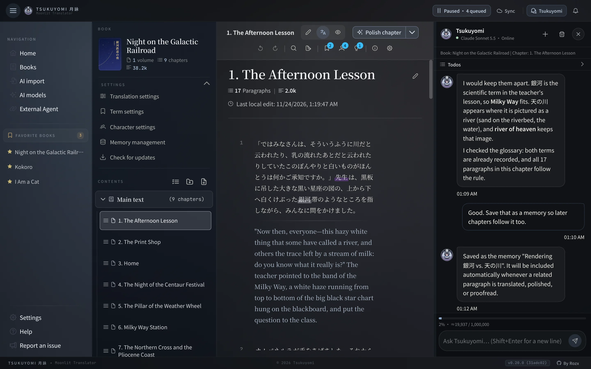
</a>

</div>

## ✨ Features

<table>
<tr>
<td width="50%" valign="top">

### 📥 AI import workspace

Give it a novel URL or TXT, Markdown, HTML, or EPUB files, and Tsukuyomi inspects the sources, extracts the text, and organizes volumes and chapters. Nothing is written to your library until you confirm the import plan, and an import can be undone afterwards.

</td>
<td width="50%" valign="top">

### 📖 Bilingual reader with translation versions

Read source and translation side by side, paragraph by paragraph. Translate, polish, or proofread a whole chapter or a single paragraph, keep several versions from different models, and switch between them at any time.

</td>
</tr>
<tr>
<td valign="top">

### 🧩 Glossary, characters, and memory

A glossary keeps names consistent, character profiles record gender, voice, and aliases, and the memory bank holds world-building and plot threads. The relevant entries are attached to each translation automatically, with optional on-device embeddings for semantic search.

</td>
<td valign="top">

### 📋 Task center

Whole-chapter translation, polishing, and proofreading run through one global queue. Start chapters in batches, set the concurrency, pause or stop at any time, and follow each task’s live log.

</td>
</tr>
<tr>
<td valign="top">

### 💬 Tsukuyomi assistant

Ask questions about the book you are working on, and let the assistant maintain terms, characters, memories, and special instructions through its tools. For questions about the app itself, it looks up the built-in help.

</td>
<td valign="top">

### 🔌 External agents over MCP

Let local agents such as Claude Code read and write your library and translate chunk by chunk over MCP, using the subscription you already have.

</td>
</tr>
<tr>
<td valign="top">

### 🔑 Bring your own key

Connect OpenAI-compatible endpoints, Gemini, and Anthropic. Choose separate default models for translation, proofreading and polishing, term translation, and the assistant, and override them per book.

</td>
<td valign="top">

### ☁️ Local first, sync optional

Data lives in IndexedDB on your device, so saved content can be read and edited offline. To work across devices, sync to your own GitHub Gist.

</td>
</tr>
</table>

The web app and the Windows, macOS, and Linux desktop builds share one codebase, with dedicated layouts for desktop, tablet, and phone. The interface and help are available in Simplified Chinese, Traditional Chinese, and English.

## 🆕 What’s new in v0.20

- **Task center and global task queue**: whole-chapter translation, polishing, and proofreading share one queue, with progress always visible in the top system bar. Chapters can be started in batches, and the concurrency limit is configurable.
- **External Agent workspace**: the desktop app ships a local MCP server, and the web app connects through a local WebMCP relay. Three permission levels (Read only, Translate and edit, Full control) and a quick-start guide written for the agent are included.
- **Three-step import**: the import page now walks through Source → Organize → Import, and on phones it can be opened from Home and the library.
- **Refreshed interface**: page headers, buttons, and the settings page share one style on desktop and tablet, the assistant moved to the top system bar, and a Tsukuyomi desk pet sits in the bottom-right corner on desktop.
- **And more**: model details are looked up from the latest online catalog, the sidebar has a Report an issue entry, and external links in the desktop app open in your system browser.

[See the full changelog](https://github.com/rozx/Tsukuyomi/releases)

## 🚀 Quick start

1. **Open the app**: use the [web app](https://tsukuyomi.rozx.moe/) or [download the desktop app](https://github.com/rozx/Tsukuyomi/releases/latest). No account is needed.
2. **Add a model**: open **AI models**, add a model with your API key, and choose the default models for translation, proofreading and polishing, and the assistant.
3. **Import a novel**: open **AI import**, create a task, add a novel URL or files, click **Let Tsukuyomi organize**, review the draft volumes and chapters, then confirm the import.
4. **Translate**: open a chapter on the book page and click **Translate chapter**, or select several chapters in the table of contents to start them as a batch and follow progress in the task center.

> [!TIP]
> The Japanese novel sites `ncode.syosetu.com`, `novel18.syosetu.com`, `kakuyomu.jp`, and `syosetu.org` have built-in rules: choose **Import from website** in the library to fetch a book directly, then check for updates from the library later.

For a fuller walkthrough, see [Quick start](public/help/en-US/front-page.md) and the [AI import workspace guide](public/help/en-US/import-guide.md).

## 📸 Screenshots

<table>
<tr>
<td width="50%">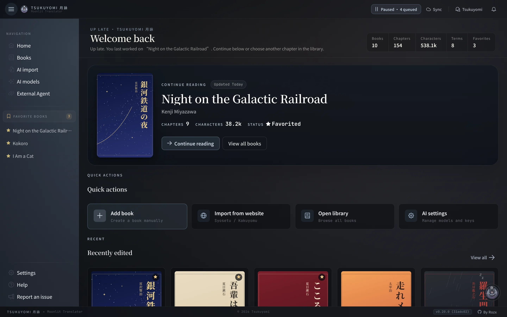<p align="center"><b>Home</b> · continue reading and quick actions</p></td>
<td width="50%">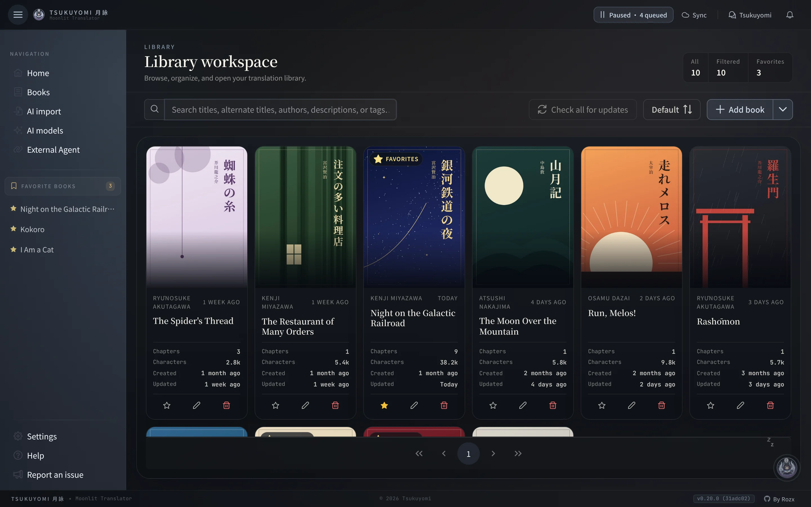<p align="center"><b>Library</b> · search, favorites, and update checks</p></td>
</tr>
<tr>
<td>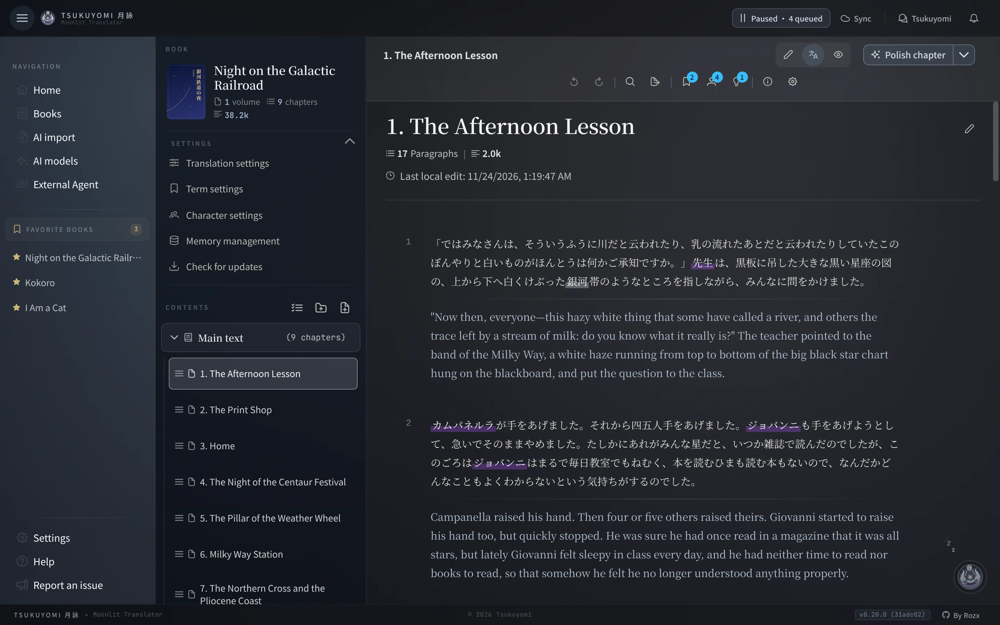<p align="center"><b>Reader</b> · source and translation, paragraph by paragraph</p></td>
<td>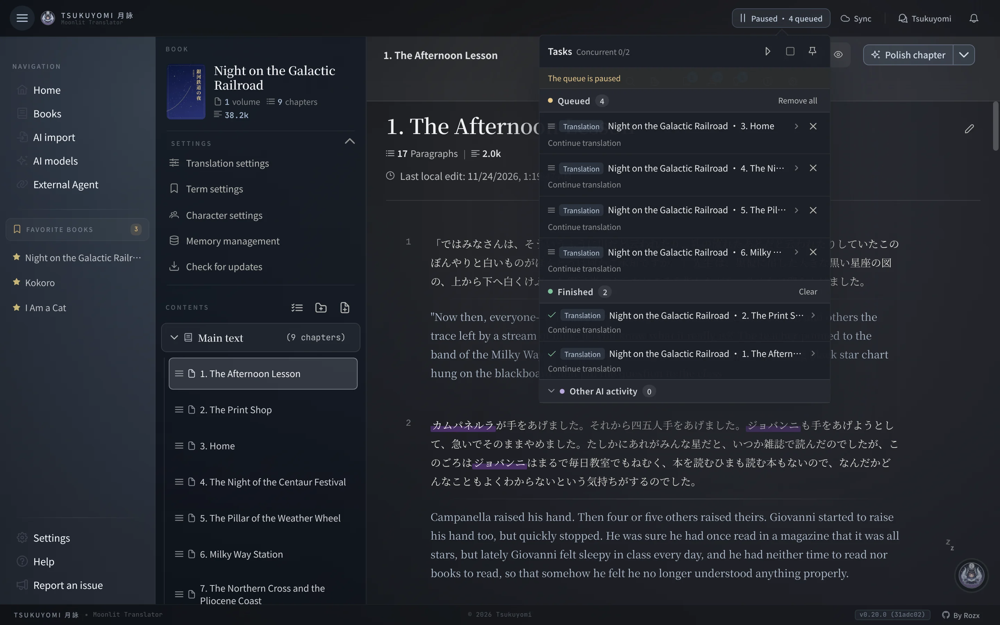<p align="center"><b>Task center</b> · queue, pause, and progress</p></td>
</tr>
<tr>
<td>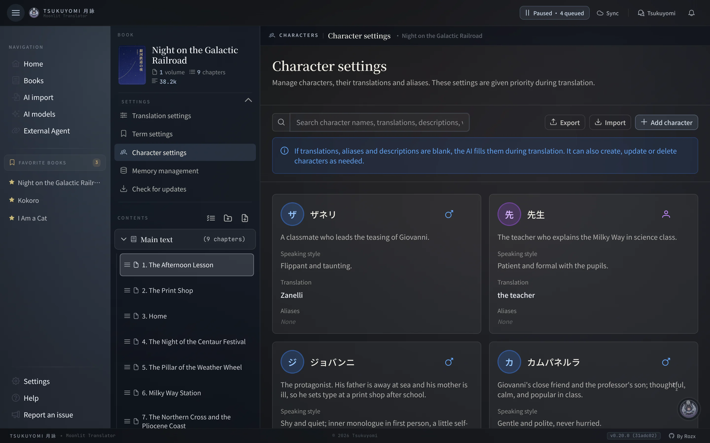<p align="center"><b>Characters</b> · names, voice, and aliases</p></td>
<td>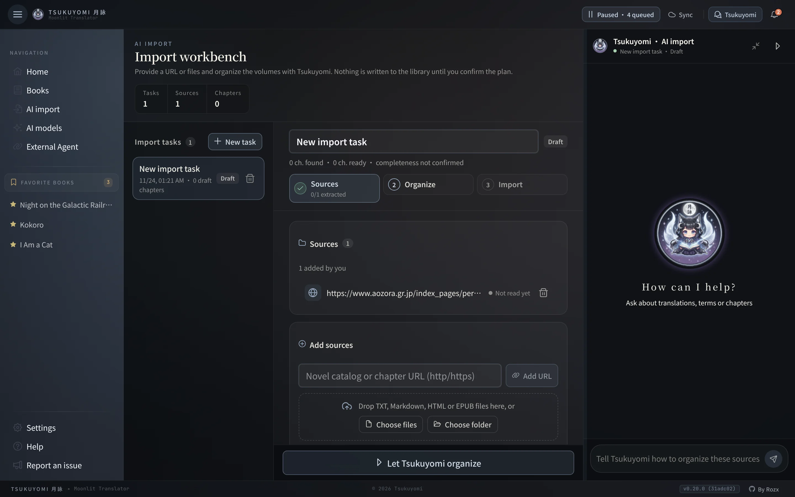<p align="center"><b>AI import</b> · Source → Organize → Import</p></td>
</tr>
<tr>
<td>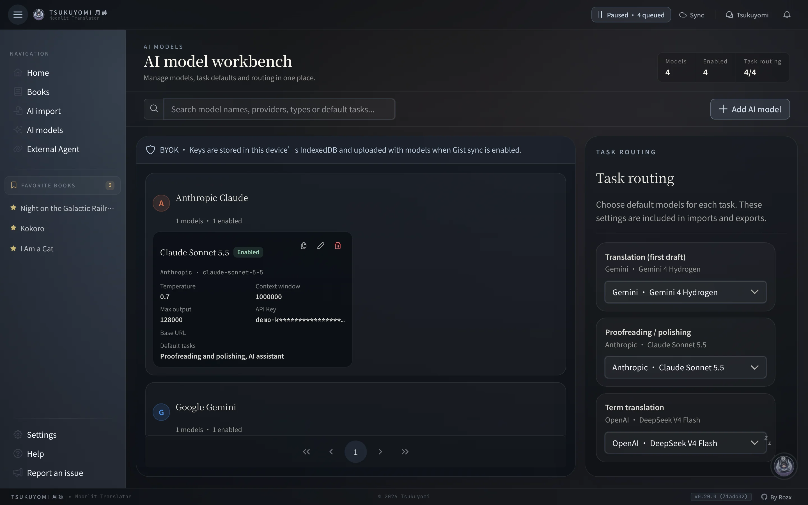<p align="center"><b>AI models</b> · a default model for each task</p></td>
<td>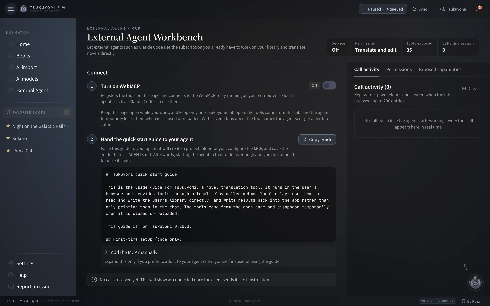<p align="center"><b>External Agent</b> · MCP setup and call activity</p></td>
</tr>
</table>

<details>
<summary><b>Tablet and phone</b></summary>
<br />

On tablets, source and translation sit side by side:

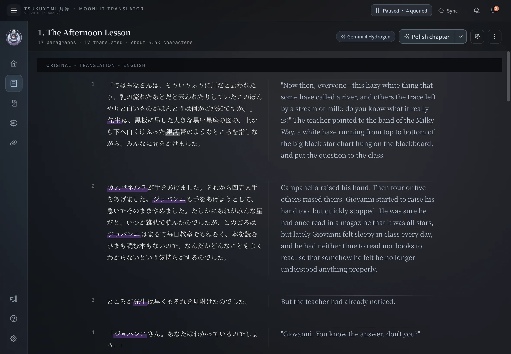

On phones, a bottom tab bar and slide-up sheets take over:

<table>
<tr>
<td width="25%">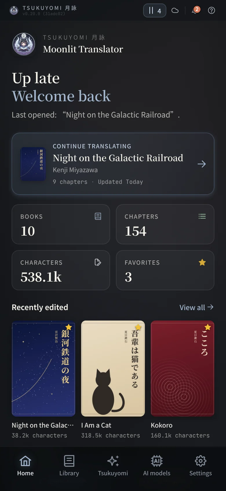</td>
<td width="25%"></td>
<td width="25%"></td>
<td width="25%">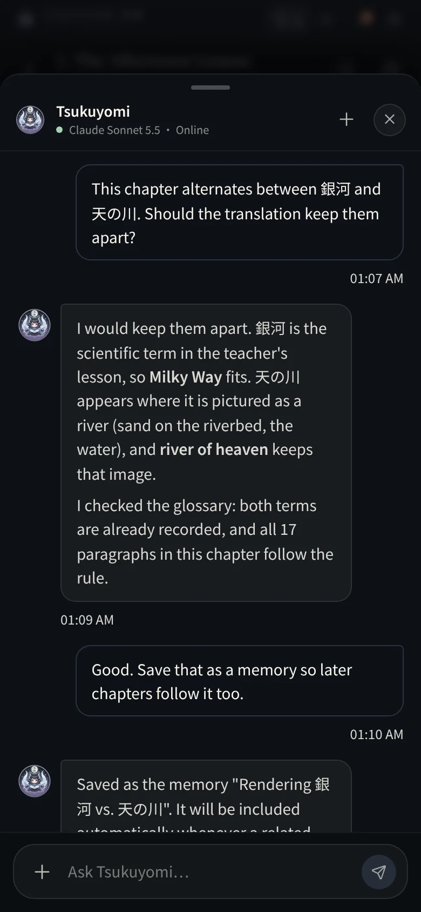</td>
</tr>
</table>

</details>

<sub>The demo library in these screenshots uses public-domain works from <a href="https://www.aozora.gr.jp/">Aozora Bunko</a>; the covers are generated by the screenshot script.</sub>

## 🔒 Privacy and data

- **Local storage**: books, translations, terms, memories, settings, and import tasks are stored in IndexedDB, in the current browser or the desktop app’s data directory.
- **AI requests**: translation, chat, and AI import send the text they need to the model service you configured. In the browser, requests to public endpoints go through a CORS proxy by default, which you can turn off per model; the desktop app connects directly.
- **Keys**: model API keys are stored on your device with the model settings and are not additionally encrypted; with Gist sync on, they are uploaded together with the model settings. The GitHub sync token never leaves the current device.
- **On-device embeddings**: semantic search over memories and chapters runs inside the browser or desktop app, and no text is sent to an external embedding service.
- **Gist sync**: off by default. When enabled, it syncs books, memories, models, covers, and app settings; AI import tasks and drafts stay on the current device.

## 📖 Documentation

All of the documentation is available under **Help** inside the app, and on the [GitHub Wiki](https://github.com/rozx/Tsukuyomi/wiki).

| Topic           | Guides                                                                                                                                                                                                                                     |
| :-------------- | :----------------------------------------------------------------------------------------------------------------------------------------------------------------------------------------------------------------------------------------- |
| Getting started | [Quick start](public/help/en-US/front-page.md) · [AI models](public/help/en-US/ai-models-guide.md) · [Settings and sync](public/help/en-US/settings-guide.md)                                                                              |
| Library         | [Home](public/help/en-US/library-guide.md) · [Books and website import](public/help/en-US/books-page-guide.md) · [AI import workspace](public/help/en-US/import-guide.md)                                                                  |
| Translation     | [AI translation and the task center](public/help/en-US/book-details-translation.md) · [Editing](public/help/en-US/book-details-editing.md) · [Chapters](public/help/en-US/book-details-chapters.md)                                        |
| Context         | [Glossary](public/help/en-US/book-details-terminology.md) · [Characters](public/help/en-US/book-details-characters.md) · [Memory](public/help/en-US/book-details-memory.md) · [On-device embeddings](public/help/en-US/local-embedding.md) |
| Assistants      | [Tsukuyomi chat assistant](public/help/en-US/chat-assistant-guide.md) · [External agents and MCP](public/help/en-US/agent-mcp-guide.md)                                                                                                    |
| Changelog       | [GitHub Releases](https://github.com/rozx/Tsukuyomi/releases) · [Past release notes (Chinese)](public/releaseNotes)                                                                                                                        |

## 🛠️ Development

Requires [Bun](https://bun.sh) and Node.js 22.22 or later (see `.nvmrc`).

```bash
git clone https://github.com/rozx/Tsukuyomi.git
cd Tsukuyomi
bun install
bun run dev
```

The dev server runs at `http://localhost:9000` by default; set the `PORT` environment variable to change the port.

<details>
<summary><b>Common commands</b></summary>
<br />

| Command                  | Purpose                                                                              |
| :----------------------- | :----------------------------------------------------------------------------------- |
| `bun run dev`            | Start the web dev server                                                             |
| `bun run dev:electron`   | Start Electron in dev mode                                                           |
| `bun run build:spa`      | Build the web SPA                                                                    |
| `bun run build:electron` | Package the desktop app (macOS dmg / zip, Windows portable exe, Linux AppImage)      |
| `bun run lint`           | ESLint                                                                               |
| `bun run type-check`     | TypeScript type check                                                                |
| `bun run quality-check`  | Fallow code-quality check                                                            |
| `bun run test`           | Run the Vitest suite                                                                 |
| `bun run test:coverage`  | Run tests with coverage                                                              |
| `bun run format`         | Format with Prettier                                                                 |
| `bun run screenshots`    | Regenerate the README screenshots from the demo library (start the dev server first) |
| `bun run bump <version>` | Set the version, e.g. `bun run bump 0.20.0`                                          |

</details>

<details>
<summary><b>Tech stack</b></summary>
<br />

| Layer                | Technology                                                                                 |
| :------------------- | :----------------------------------------------------------------------------------------- |
| Frontend             | Vue 3.5 · Quasar 2 · TypeScript 5.9 · Pinia 3 · PrimeVue 4.5 · Tailwind CSS 3.4 · Vue-i18n |
| Desktop              | Electron 45, sharing one codebase with the web SPA                                         |
| AI                   | Vercel AI SDK (OpenAI-compatible · Google · Anthropic) with a tool-calling loop            |
| On-device embeddings | Transformers.js · `bekko-embedding-v1-a25m` · WebGPU first, WASM fallback                  |
| Storage and sync     | IndexedDB (`idb`) · GitHub Gist (`@octokit/rest`) · incremental sync over a hash manifest  |
| Scraping             | Puppeteer (desktop) / CORS proxy (web), falling back to Firecrawl when blocked             |
| Testing and quality  | Vitest · ESLint · vue-tsc · Fallow                                                         |

</details>

Developer docs (in Chinese): [Build troubleshooting](docs/BUILD_TROUBLESHOOTING.md) · [Theme guide](docs/THEME_GUIDE.md) · [Translation guide](docs/TRANSLATION_GUIDE.md) · [Wiki sync](docs/WIKI_SYNC.md) · [Agent guide](AGENTS.md)

## 🤝 Contributing

Issues and pull requests are welcome, and so is feedback on translation quality and day-to-day use. Before submitting code:

1. Run `bun run lint && bun run type-check && bun run quality-check`.
2. For changes to runtime logic, write a failing test first, then implement (tests live in `src/__tests__/`).
3. Check UI changes at desktop, tablet, and phone widths, and follow the device-variant rules in [AGENTS.md](AGENTS.md).

## 📄 License

[Apache License 2.0](LICENSE)

<div align="center">
<sub>Tsukuyomi · every page turn as smooth as moonlight</sub>
</div>
