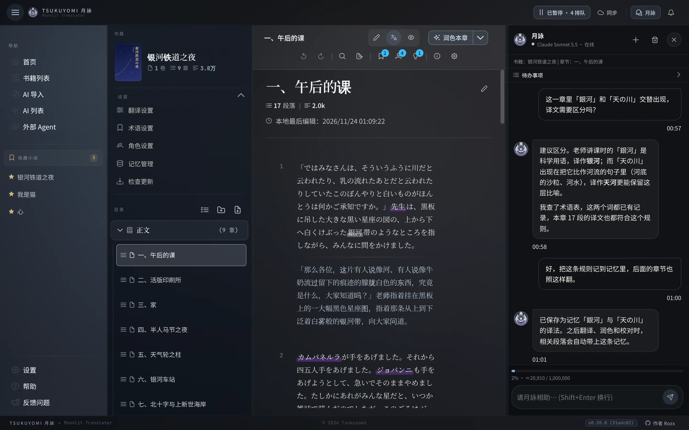
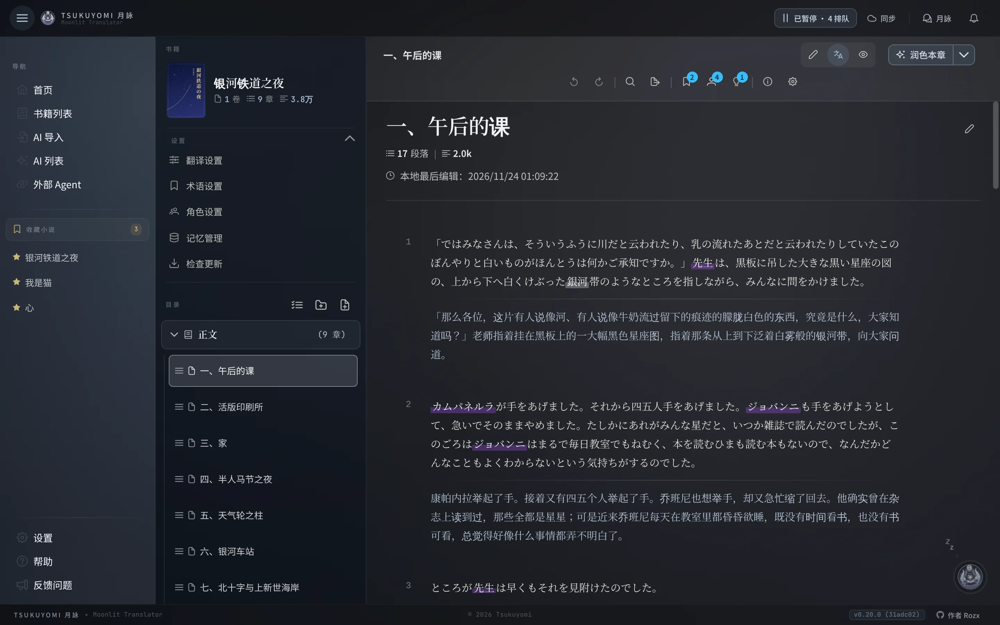
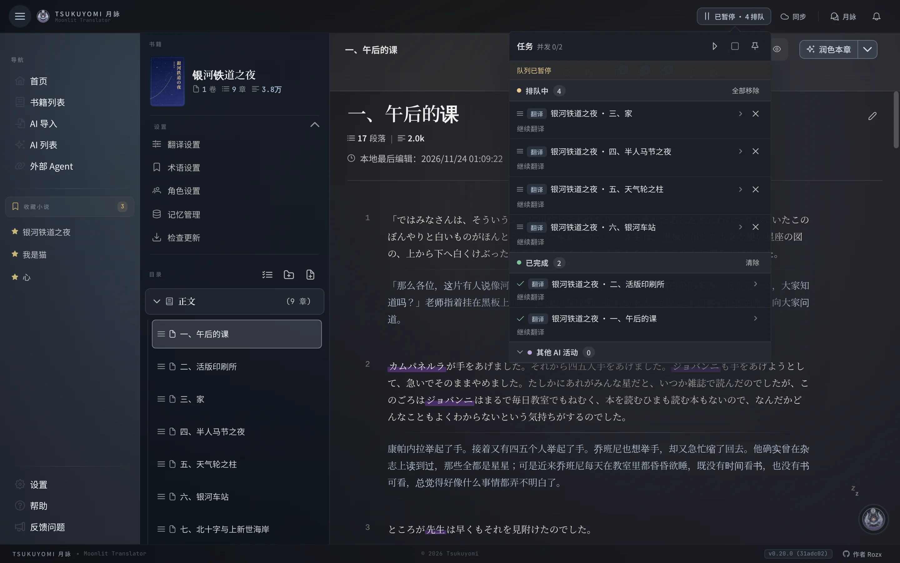
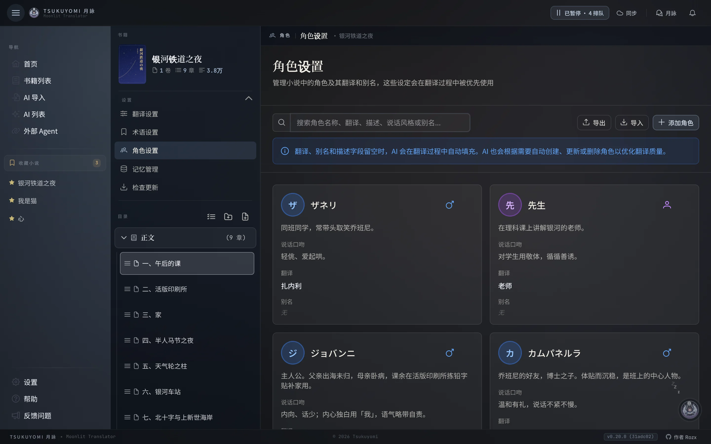
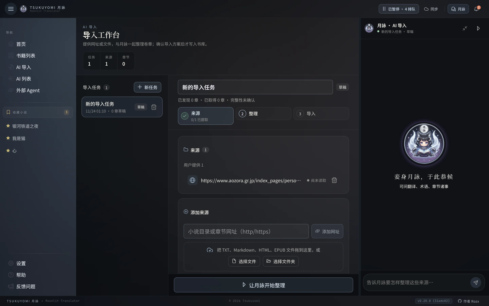
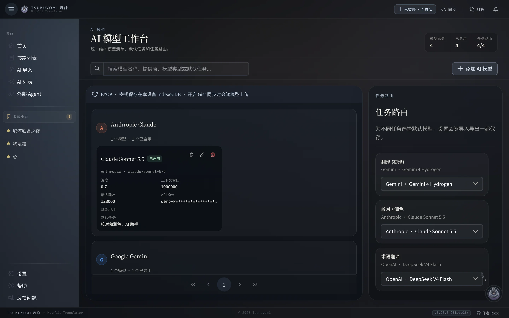
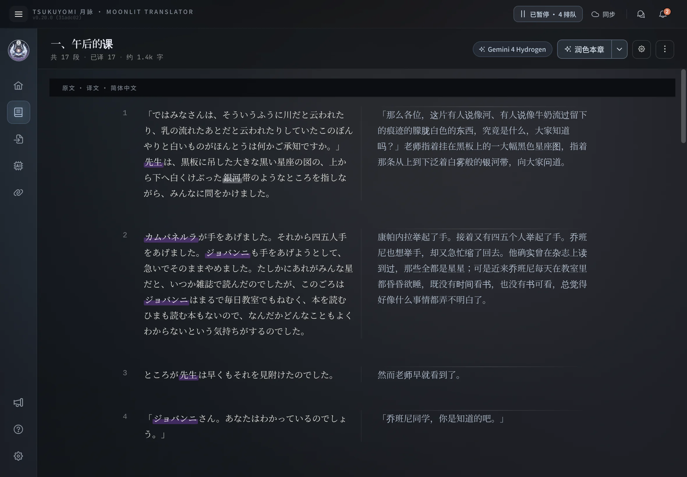
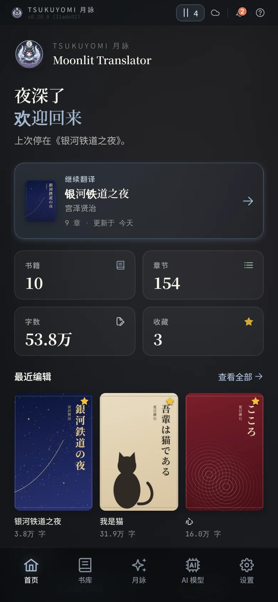
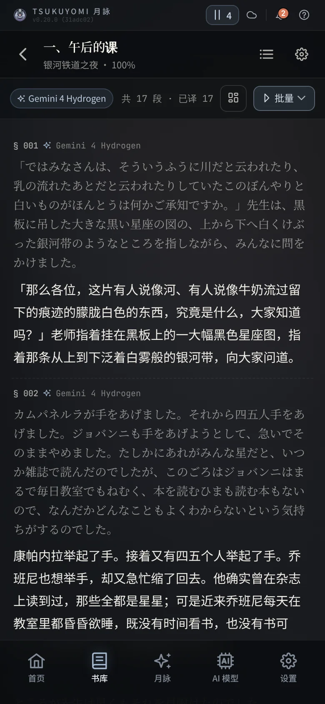

<div align="center">


# Tsukuyomi · 月詠

**面向小说的 AI 导入、阅读与翻译工作台**

原文不限语言，可译为简体中文、繁體中文或 English，对日文网络小说与轻小说有专门支持。<br />
使用你自己的 API Key，数据保存在你自己的设备上。

[](https://github.com/rozx/Tsukuyomi/releases/latest)
[](https://github.com/rozx/Tsukuyomi/releases)
[](https://github.com/rozx/Tsukuyomi/stargazers)
[](LICENSE)
[](https://github.com/rozx/Tsukuyomi/commits/main)

[**打开网页版**](https://tsukuyomi.rozx.moe/) · [**下载桌面版**](https://github.com/rozx/Tsukuyomi/releases/latest) · [使用文档](#-文档) · [更新日志](https://github.com/rozx/Tsukuyomi/releases) · [反馈问题](https://github.com/rozx/Tsukuyomi/issues)

**简体中文** · [繁體中文](README.zh-TW.md) · [English](README.en-US.md)

<a href="https://tsukuyomi.rozx.moe/">
  
</a>

</div>

## ✨ 特性

<table>
<tr>
<td width="50%" valign="top">

### 📥 AI 导入工作台

提供小说网址，或 TXT、Markdown、HTML、EPUB 文件，月詠会检查来源、提取正文、整理卷章。确认导入方案后才写入书库，导入后还能撤销。

</td>
<td width="50%" valign="top">

### 📖 双语阅读与多版本译文

按段落对照原文和译文，整章或单段翻译、润色、校对。同一段落可以保留不同模型的多个版本，随时切换。

</td>
</tr>
<tr>
<td valign="top">

### 🧩 术语、角色与记忆

术语表统一译名，角色设定记录性别、口吻和别名，记忆库沉淀世界观与伏笔。翻译时自动带上相关内容，也可以开启本地嵌入做语义检索。

</td>
<td valign="top">

### 📋 任务中心

整章的翻译、润色、校对进入全局队列：批量启动、设置并发数、随时暂停或停止，并查看每个任务的实时日志。

</td>
</tr>
<tr>
<td valign="top">

### 💬 月詠助手

结合当前书籍回答问题，并通过工具直接维护术语、角色、记忆和特殊指令。遇到软件用法问题，它会查阅内置帮助文档。

</td>
<td valign="top">

### 🔌 外部 Agent / MCP

让 Claude Code 等本地 Agent 通过 MCP 读写书库、分块翻译，用你已有的订阅额度完成整本书。

</td>
</tr>
<tr>
<td valign="top">

### 🔑 自带密钥（BYOK）

接入 OpenAI 兼容接口、Gemini 和 Anthropic。翻译、校对 / 润色、术语翻译和助手可以分别指定默认模型，单本书还能单独覆盖。

</td>
<td valign="top">

### ☁️ 本地优先，可选同步

数据保存在本机 IndexedDB，已保存的内容可以离线阅读和编辑。需要多设备时，可以同步到你自己的 GitHub Gist。

</td>
</tr>
</table>

网页版与 Windows、macOS、Linux 桌面版共用一套代码，桌面、平板和手机各有专门的界面；界面与帮助文档提供简体中文、繁體中文和 English。

## 🆕 v0.20 更新亮点

- **任务中心与全局任务队列**：整章的翻译、润色、校对统一排队，顶部系统栏随时查看进度；支持批量启动和并发上限设置。
- **外部 Agent 工作台**：桌面版内置本地 MCP 服务，浏览器版通过 WebMCP 本地中继接入；提供「仅只读」「翻译与编辑」「完全控制」三档权限，以及给 Agent 的快速上手指南。
- **导入页三步引导**：按「来源 → 整理 → 导入」逐步完成，手机上也能从首页和书库进入导入。
- **界面翻新**：桌面与平板统一页头、按钮和设置页样式，月詠入口移到顶部系统栏，桌面端右下角新增月詠桌宠。
- **更多改进**：模型资料改为在线查询最新目录，侧边栏新增「反馈问题」入口，桌面版的外部链接改用系统浏览器打开。

[查看全部更新日志](https://github.com/rozx/Tsukuyomi/releases)

## 🚀 快速开始

1. **打开应用**：使用[网页版](https://tsukuyomi.rozx.moe/)，或[下载桌面版](https://github.com/rozx/Tsukuyomi/releases/latest)。不需要注册账号。
2. **添加模型**：打开「AI 列表」，填入 API Key 添加模型，并为翻译、校对 / 润色和助手选择默认模型。
3. **导入小说**：打开「AI 导入」新建任务，添加小说网址或文件，点击「让月詠开始整理」，检查卷章草稿后确认导入。
4. **开始翻译**：在书籍详情页打开章节，点击「翻译本章」；也可以在目录里多选章节批量启动，在任务中心查看进度。

> [!TIP]
> 日文小说网站 `ncode.syosetu.com`、`novel18.syosetu.com`、`kakuyomu.jp`、`syosetu.org` 有内置规则，可以在书库中选择「从网站导入」直接抓取，之后在书库里检查更新。

更详细的步骤见[快速开始](public/help/zh-CN/front-page.md)和 [AI 导入工作台指南](public/help/zh-CN/import-guide.md)。

## 📸 界面预览

<table>
<tr>
<td width="50%"><p align="center"><b>首页</b> · 继续阅读与快速操作</p></td>
<td width="50%"><p align="center"><b>书库</b> · 搜索、收藏与检查更新</p></td>
</tr>
<tr>
<td><p align="center"><b>阅读器</b> · 原文译文逐段对照</p></td>
<td><p align="center"><b>任务中心</b> · 排队、暂停与进度</p></td>
</tr>
<tr>
<td><p align="center"><b>角色设定</b> · 译名、口吻与别名</p></td>
<td><p align="center"><b>AI 导入</b> · 来源 → 整理 → 导入</p></td>
</tr>
<tr>
<td><p align="center"><b>AI 模型</b> · 按任务分配默认模型</p></td>
<td><p align="center"><b>外部 Agent</b> · MCP 接入与调用记录</p></td>
</tr>
</table>

<details>
<summary><b>平板与手机</b></summary>
<br />

平板采用原文、译文并排的双栏阅读：



手机使用底部标签栏和上滑面板：

<table>
<tr>
<td width="25%"></td>
<td width="25%"></td>
<td width="25%"></td>
<td width="25%"></td>
</tr>
</table>

</details>

<sub>截图中的演示书库取自<a href="https://www.aozora.gr.jp/">青空文库</a>的公有领域作品，封面由截图脚本生成。</sub>

## 🔒 隐私与数据

- **本地存储**：书籍、译文、术语、记忆、配置和导入任务保存在当前浏览器或桌面版数据目录的 IndexedDB 中。
- **AI 请求**：翻译、聊天和 AI 导入会把所需文本发送给你配置的模型服务。浏览器端的公网请求默认经过 CORS 代理，可以按模型关闭；桌面版直连。
- **密钥**：模型 API Key 随模型配置保存在本机，应用不会额外加密；开启 Gist 同步后会随模型配置一起上传。GitHub 同步 Token 只留在当前设备。
- **本地嵌入**：记忆与章节的语义检索在浏览器或桌面版内部运行，不把文本上传到外部嵌入服务。
- **Gist 同步**：默认关闭。开启后同步书籍、记忆、模型、封面和应用设置；AI 导入任务与草稿只留在当前设备。

## 📖 文档

应用内「帮助」可以直接查阅全部文档，也可以在 [GitHub Wiki](https://github.com/rozx/Tsukuyomi/wiki) 阅读。

| 主题     | 文档                                                                                                                                                                                                                           |
| :------- | :----------------------------------------------------------------------------------------------------------------------------------------------------------------------------------------------------------------------------- |
| 上手     | [快速开始](public/help/zh-CN/front-page.md) · [AI 模型配置](public/help/zh-CN/ai-models-guide.md) · [设置与同步](public/help/zh-CN/settings-guide.md)                                                                          |
| 书库     | [主页介绍](public/help/zh-CN/library-guide.md) · [书籍列表与网站导入](public/help/zh-CN/books-page-guide.md) · [AI 导入工作台](public/help/zh-CN/import-guide.md)                                                              |
| 翻译     | [AI 翻译与任务中心](public/help/zh-CN/book-details-translation.md) · [内容编辑](public/help/zh-CN/book-details-editing.md) · [章节管理](public/help/zh-CN/book-details-chapters.md)                                            |
| 上下文   | [术语管理](public/help/zh-CN/book-details-terminology.md) · [角色设定](public/help/zh-CN/book-details-characters.md) · [记忆管理](public/help/zh-CN/book-details-memory.md) · [本地嵌入](public/help/zh-CN/local-embedding.md) |
| 助手     | [月詠 · 聊天助手](public/help/zh-CN/chat-assistant-guide.md) · [外部 Agent / MCP 接入](public/help/zh-CN/agent-mcp-guide.md)                                                                                                   |
| 更新日志 | [GitHub Releases](https://github.com/rozx/Tsukuyomi/releases) · [历史发布说明](public/releaseNotes)                                                                                                                            |

## 🛠️ 开发

需要 [Bun](https://bun.sh) 和 Node.js 22.22 及以上（版本见 `.nvmrc`）。

```bash
git clone https://github.com/rozx/Tsukuyomi.git
cd Tsukuyomi
bun install
bun run dev
```

开发服务器默认在 `http://localhost:9000`，可以用 `PORT` 环境变量修改端口。

<details>
<summary><b>常用命令</b></summary>
<br />

| 命令                     | 用途                                                              |
| :----------------------- | :---------------------------------------------------------------- |
| `bun run dev`            | 启动 Web 开发服务器                                               |
| `bun run dev:electron`   | 启动 Electron 开发模式                                            |
| `bun run build:spa`      | 构建 Web SPA                                                      |
| `bun run build:electron` | 打包桌面版（macOS dmg / zip，Windows 便携版 exe，Linux AppImage） |
| `bun run lint`           | ESLint 检查                                                       |
| `bun run type-check`     | TypeScript 类型检查                                               |
| `bun run quality-check`  | Fallow 代码质量检查                                               |
| `bun run test`           | 运行 Vitest 测试                                                  |
| `bun run test:coverage`  | 运行测试并生成覆盖率                                              |
| `bun run format`         | Prettier 格式化                                                   |
| `bun run screenshots`    | 用演示书库重新生成 README 截图（需要先启动开发服务器）            |
| `bun run bump <version>` | 更新版本号，例如 `bun run bump 0.20.0`                            |

</details>

<details>
<summary><b>技术栈</b></summary>
<br />

| 层级       | 技术                                                                                       |
| :--------- | :----------------------------------------------------------------------------------------- |
| 前端       | Vue 3.5 · Quasar 2 · TypeScript 5.9 · Pinia 3 · PrimeVue 4.5 · Tailwind CSS 3.4 · Vue-i18n |
| 桌面       | Electron 45，与 Web SPA 共用同一份代码                                                     |
| AI         | Vercel AI SDK（OpenAI 兼容 · Google · Anthropic），工具调用循环                            |
| 本地嵌入   | Transformers.js · `bekko-embedding-v1-a25m` · WebGPU 优先，WASM 回退                       |
| 存储与同步 | IndexedDB（`idb`）· GitHub Gist（`@octokit/rest`）· 基于哈希清单的增量同步                 |
| 抓取       | Puppeteer（桌面版）/ CORS 代理（网页版），被拦截时回退 Firecrawl                           |
| 测试与质量 | Vitest · ESLint · vue-tsc · Fallow                                                         |

</details>

开发者文档：[构建故障排查](docs/BUILD_TROUBLESHOOTING.md) · [主题指南](docs/THEME_GUIDE.md) · [翻译指南](docs/TRANSLATION_GUIDE.md) · [Wiki 同步](docs/WIKI_SYNC.md) · [代理协作指南](AGENTS.md)

## 🤝 贡献

欢迎提交 Issue 和 Pull Request，也欢迎反馈翻译效果和使用体验。提交代码前请：

1. 运行 `bun run lint && bun run type-check && bun run quality-check`。
2. 运行时逻辑的改动先写失败的测试，再实现（测试在 `src/__tests__/`）。
3. 界面改动在桌面、平板和手机三种宽度下验证，并遵循 [AGENTS.md](AGENTS.md) 的设备变体规则。

## 📄 许可证

[Apache License 2.0](LICENSE)

<div align="center">
<sub>Tsukuyomi · 让每一次翻页都如月光般流畅</sub>
</div>
