<div align="center">


# Tsukuyomi · 月詠

**面向小說的 AI 匯入、閱讀與翻譯工作台**

原文不限語言，可譯為簡體中文、繁體中文或 English，對日文網路小說與輕小說有專門支援。<br />
使用你自己的 API Key，資料儲存在你自己的裝置上。

[](https://github.com/rozx/Tsukuyomi/releases/latest)
[](https://github.com/rozx/Tsukuyomi/releases)
[](https://github.com/rozx/Tsukuyomi/stargazers)
[](LICENSE)
[](https://github.com/rozx/Tsukuyomi/commits/main)

[**開啟網頁版**](https://tsukuyomi.rozx.moe/) · [**下載桌面版**](https://github.com/rozx/Tsukuyomi/releases/latest) · [使用文件](#-文件) · [更新紀錄](https://github.com/rozx/Tsukuyomi/releases) · [回報問題](https://github.com/rozx/Tsukuyomi/issues)

[简体中文](README.md) · **繁體中文** · [English](README.en-US.md)

<a href="https://tsukuyomi.rozx.moe/">
  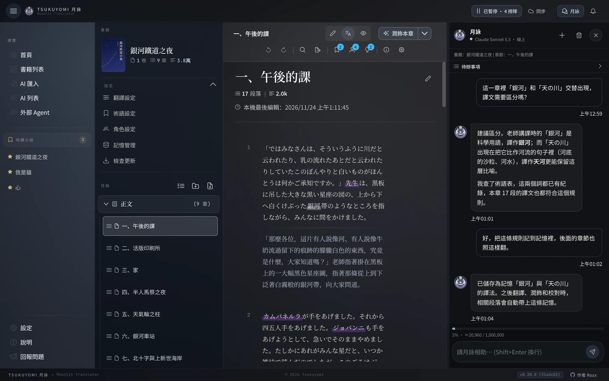
</a>

</div>

## ✨ 特性

<table>
<tr>
<td width="50%" valign="top">

### 📥 AI 匯入工作台

提供小說網址，或 TXT、Markdown、HTML、EPUB 檔案，月詠會檢查來源、擷取正文、整理卷章。確認匯入方案後才寫入書庫，匯入後還能復原。

</td>
<td width="50%" valign="top">

### 📖 雙語閱讀與多版本譯文

按段落對照原文和譯文，整章或單段翻譯、潤飾、校對。同一段落可以保留不同模型的多個版本，隨時切換。

</td>
</tr>
<tr>
<td valign="top">

### 🧩 術語、角色與記憶

術語表統一譯名，角色設定記錄性別、口吻和別名，記憶庫累積世界觀與伏筆。翻譯時自動帶上相關內容，也可以開啟本地嵌入做語意檢索。

</td>
<td valign="top">

### 📋 任務中心

整章的翻譯、潤飾、校對進入全域佇列：批次啟動、設定並行數、隨時暫停或停止，並查看每個任務的即時紀錄。

</td>
</tr>
<tr>
<td valign="top">

### 💬 月詠助手

結合目前的書籍回答問題，並透過工具直接維護術語、角色、記憶和特殊指令。遇到軟體用法問題，它會查閱內建說明文件。

</td>
<td valign="top">

### 🔌 外部 Agent / MCP

讓 Claude Code 等本機 Agent 透過 MCP 讀寫書庫、分塊翻譯，用你已有的訂閱額度完成整本書。

</td>
</tr>
<tr>
<td valign="top">

### 🔑 自備金鑰（BYOK）

接入 OpenAI 相容介面、Gemini 和 Anthropic。翻譯、校對 / 潤飾、術語翻譯和助手可以分別指定預設模型，單本書還能個別覆寫。

</td>
<td valign="top">

### ☁️ 本機優先，可選同步

資料儲存在本機 IndexedDB，已儲存的內容可以離線閱讀和編輯。需要多裝置時，可以同步到你自己的 GitHub Gist。

</td>
</tr>
</table>

網頁版與 Windows、macOS、Linux 桌面版共用一套程式碼，桌面、平板和手機各有專門的介面；介面與說明文件提供簡體中文、繁體中文和 English。

## 🆕 v0.20 更新亮點

- **任務中心與全域任務佇列**：整章的翻譯、潤飾、校對統一排隊，頂部系統列隨時查看進度；支援批次啟動和並行上限設定。
- **外部 Agent 工作台**：桌面版內建本機 MCP 服務，瀏覽器版透過 WebMCP 本機中繼接入；提供「僅唯讀」「翻譯與編輯」「完全控制」三級權限，以及給 Agent 的快速上手指南。
- **匯入頁三步引導**：按「來源 → 整理 → 匯入」逐步完成，手機上也能從首頁和書庫進入匯入。
- **介面翻新**：桌面與平板統一頁首、按鈕和設定頁樣式，月詠入口移到頂部系統列，桌面端右下角新增月詠桌寵。
- **更多改進**：模型資料改為線上查詢最新目錄，側邊欄新增「回報問題」入口，桌面版的外部連結改用系統瀏覽器開啟。

[查看全部更新紀錄](https://github.com/rozx/Tsukuyomi/releases)

## 🚀 快速開始

1. **開啟應用程式**：使用[網頁版](https://tsukuyomi.rozx.moe/)，或[下載桌面版](https://github.com/rozx/Tsukuyomi/releases/latest)。不需要註冊帳號。
2. **新增模型**：開啟「AI 列表」，填入 API Key 新增模型，並為翻譯、校對 / 潤飾和助手選擇預設模型。
3. **匯入小說**：開啟「AI 匯入」新建任務，加入小說網址或檔案，點選「讓月詠開始整理」，檢查卷章草稿後確認匯入。
4. **開始翻譯**：在書籍詳情頁開啟章節，點選「翻譯本章」；也可以在目錄裡多選章節批次啟動，在任務中心查看進度。

> [!TIP]
> 日文小說網站 `ncode.syosetu.com`、`novel18.syosetu.com`、`kakuyomu.jp`、`syosetu.org` 有內建規則，可以在書庫中選擇「從網站匯入」直接擷取，之後在書庫裡檢查更新。

更詳細的步驟見[快速開始](public/help/zh-TW/front-page.md)和 [AI 匯入工作台指南](public/help/zh-TW/import-guide.md)。

## 📸 介面預覽

<table>
<tr>
<td width="50%"><p align="center"><b>首頁</b> · 繼續閱讀與快速操作</p></td>
<td width="50%">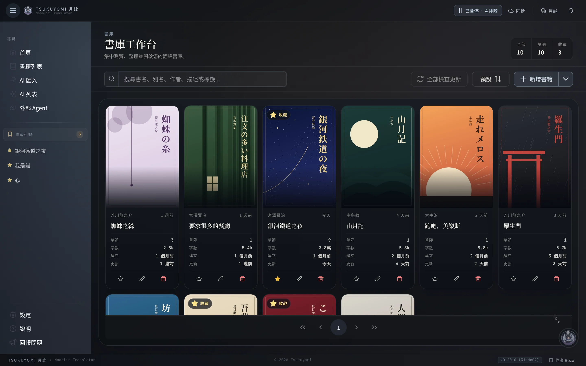<p align="center"><b>書庫</b> · 搜尋、收藏與檢查更新</p></td>
</tr>
<tr>
<td>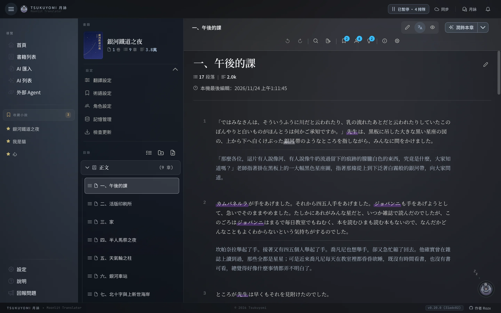<p align="center"><b>閱讀器</b> · 原文譯文逐段對照</p></td>
<td>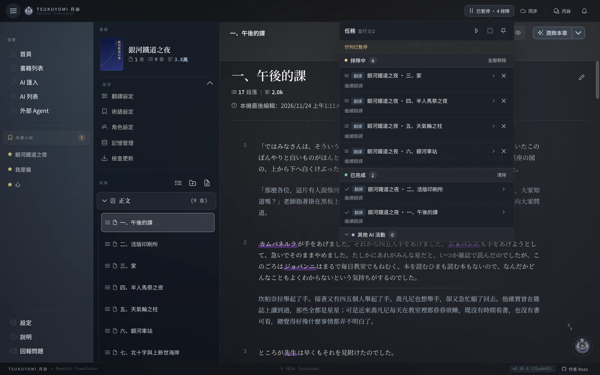<p align="center"><b>任務中心</b> · 排隊、暫停與進度</p></td>
</tr>
<tr>
<td>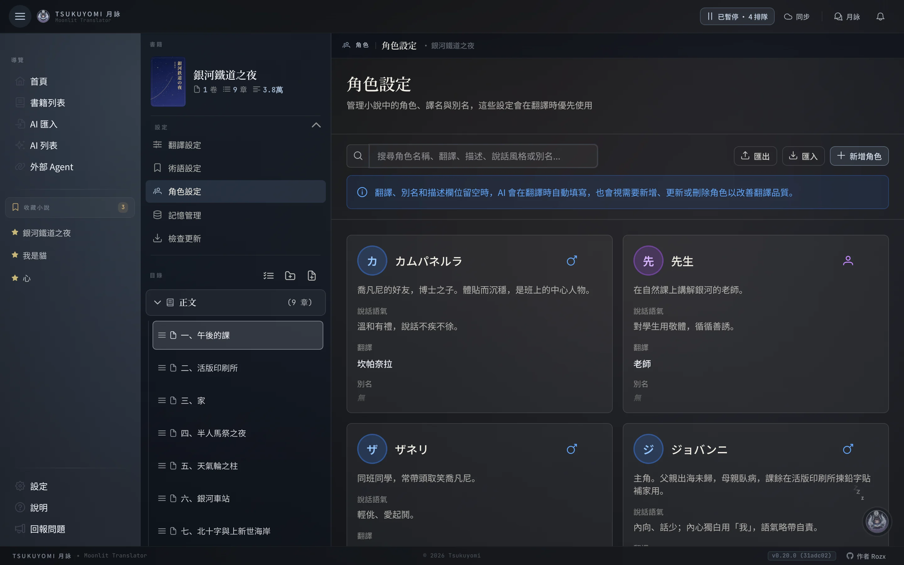<p align="center"><b>角色設定</b> · 譯名、口吻與別名</p></td>
<td>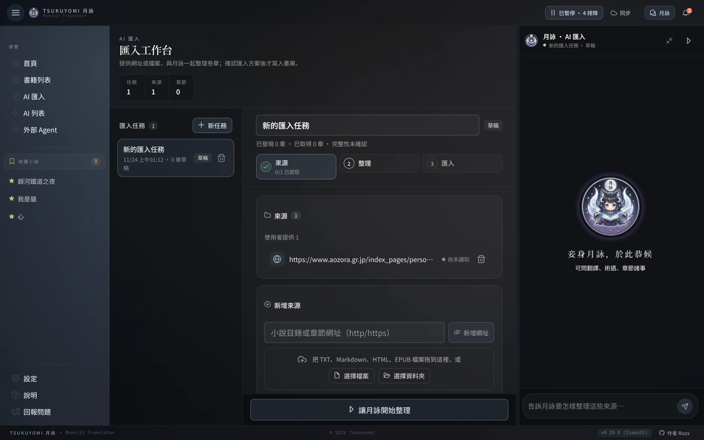<p align="center"><b>AI 匯入</b> · 來源 → 整理 → 匯入</p></td>
</tr>
<tr>
<td>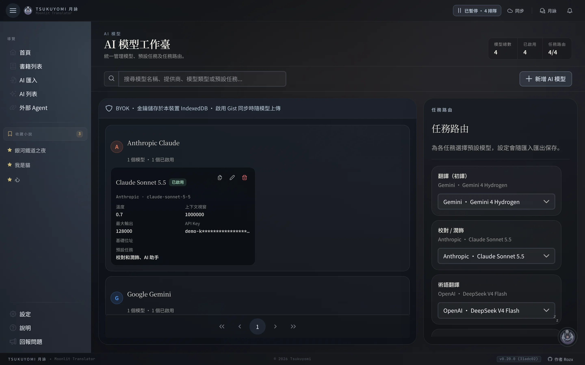<p align="center"><b>AI 模型</b> · 按任務指定預設模型</p></td>
<td>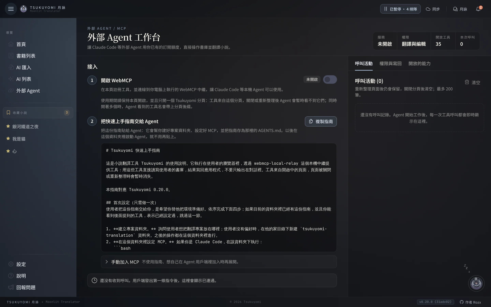<p align="center"><b>外部 Agent</b> · MCP 接入與呼叫紀錄</p></td>
</tr>
</table>

<details>
<summary><b>平板與手機</b></summary>
<br />

平板採用原文、譯文並排的雙欄閱讀：

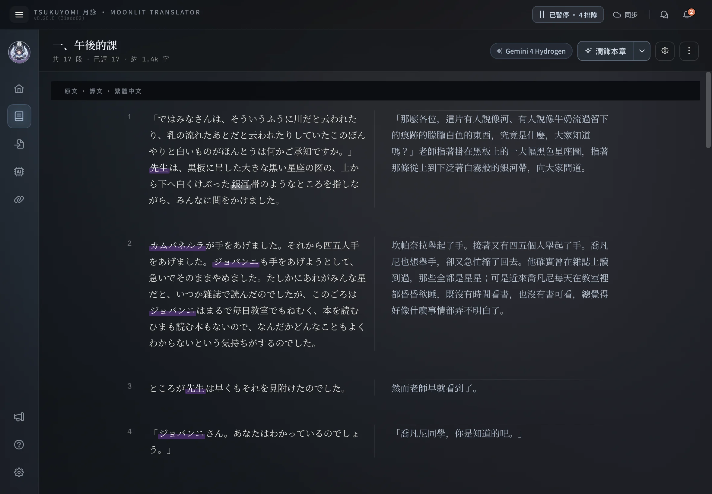

手機使用底部分頁列和上滑面板：

<table>
<tr>
<td width="25%">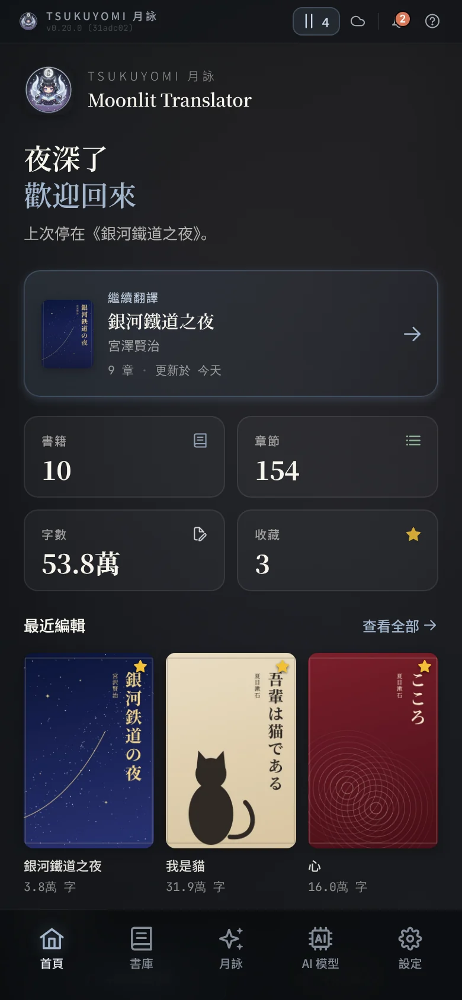</td>
<td width="25%"></td>
<td width="25%">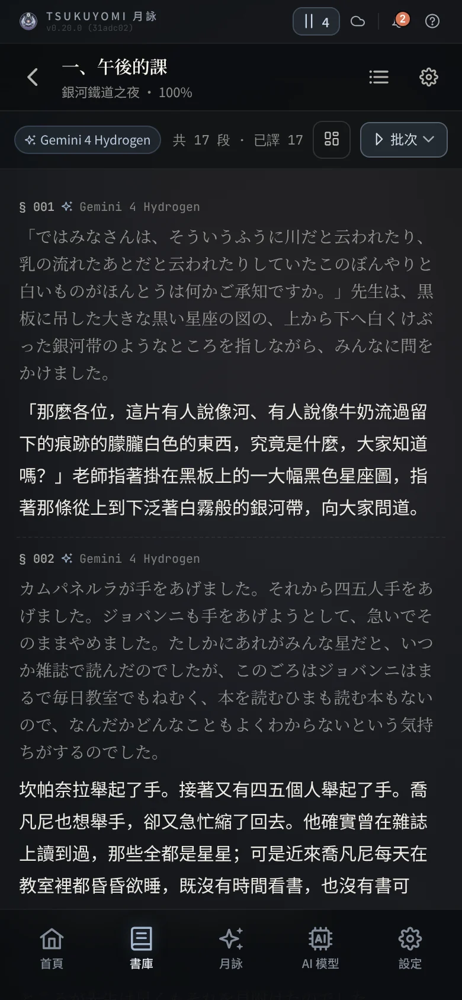</td>
<td width="25%">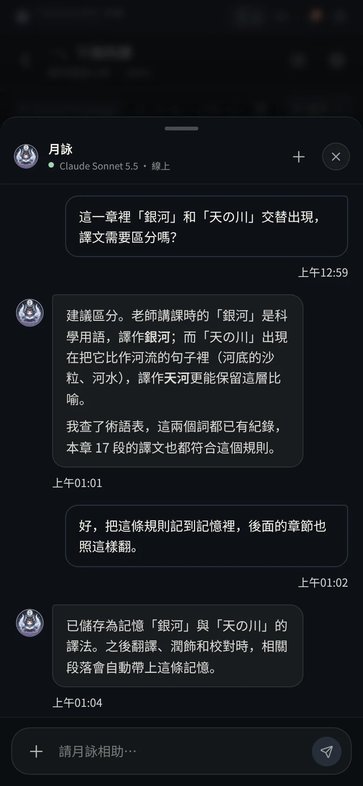</td>
</tr>
</table>

</details>

<sub>截圖中的示範書庫取自<a href="https://www.aozora.gr.jp/">青空文庫</a>的公有領域作品，封面由截圖指令碼產生。</sub>

## 🔒 隱私與資料

- **本機儲存**：書籍、譯文、術語、記憶、設定和匯入任務儲存在目前瀏覽器或桌面版資料目錄的 IndexedDB 中。
- **AI 請求**：翻譯、聊天和 AI 匯入會把所需文字傳送給你設定的模型服務。瀏覽器端的公網請求預設經過 CORS 代理，可以按模型關閉；桌面版直連。
- **金鑰**：模型 API Key 隨模型設定儲存在本機，應用程式不會額外加密；開啟 Gist 同步後會隨模型設定一起上傳。GitHub 同步 Token 只留在目前的裝置。
- **本地嵌入**：記憶與章節的語意檢索在瀏覽器或桌面版內部執行，不把文字上傳到外部嵌入服務。
- **Gist 同步**：預設關閉。開啟後同步書籍、記憶、模型、封面和應用程式設定；AI 匯入任務與草稿只留在目前的裝置。

## 📖 文件

應用程式內「說明」可以直接查閱全部文件，也可以在 [GitHub Wiki](https://github.com/rozx/Tsukuyomi/wiki) 閱讀。

| 主題     | 文件                                                                                                                                                                                                                           |
| :------- | :----------------------------------------------------------------------------------------------------------------------------------------------------------------------------------------------------------------------------- |
| 上手     | [快速開始](public/help/zh-TW/front-page.md) · [AI 模型配置](public/help/zh-TW/ai-models-guide.md) · [設定與同步](public/help/zh-TW/settings-guide.md)                                                                          |
| 書庫     | [主頁介紹](public/help/zh-TW/library-guide.md) · [書籍列表與網站匯入](public/help/zh-TW/books-page-guide.md) · [AI 匯入工作台](public/help/zh-TW/import-guide.md)                                                              |
| 翻譯     | [AI 翻譯與任務中心](public/help/zh-TW/book-details-translation.md) · [內容編輯](public/help/zh-TW/book-details-editing.md) · [章節管理](public/help/zh-TW/book-details-chapters.md)                                            |
| 上下文   | [術語管理](public/help/zh-TW/book-details-terminology.md) · [角色設定](public/help/zh-TW/book-details-characters.md) · [記憶管理](public/help/zh-TW/book-details-memory.md) · [本地嵌入](public/help/zh-TW/local-embedding.md) |
| 助手     | [月詠 · 聊天助手](public/help/zh-TW/chat-assistant-guide.md) · [外部 Agent / MCP 接入](public/help/zh-TW/agent-mcp-guide.md)                                                                                                   |
| 更新紀錄 | [GitHub Releases](https://github.com/rozx/Tsukuyomi/releases) · [歷史發布說明（簡體中文）](public/releaseNotes)                                                                                                                |

## 🛠️ 開發

需要 [Bun](https://bun.sh) 和 Node.js 22.22 以上（版本見 `.nvmrc`）。

```bash
git clone https://github.com/rozx/Tsukuyomi.git
cd Tsukuyomi
bun install
bun run dev
```

開發伺服器預設在 `http://localhost:9000`，可以用 `PORT` 環境變數修改連接埠。

<details>
<summary><b>常用指令</b></summary>
<br />

| 指令                     | 用途                                                                |
| :----------------------- | :------------------------------------------------------------------ |
| `bun run dev`            | 啟動 Web 開發伺服器                                                 |
| `bun run dev:electron`   | 啟動 Electron 開發模式                                              |
| `bun run build:spa`      | 建置 Web SPA                                                        |
| `bun run build:electron` | 打包桌面版（macOS dmg / zip，Windows 免安裝版 exe，Linux AppImage） |
| `bun run lint`           | ESLint 檢查                                                         |
| `bun run type-check`     | TypeScript 型別檢查                                                 |
| `bun run quality-check`  | Fallow 程式碼品質檢查                                               |
| `bun run test`           | 執行 Vitest 測試                                                    |
| `bun run test:coverage`  | 執行測試並產生覆蓋率                                                |
| `bun run format`         | Prettier 格式化                                                     |
| `bun run screenshots`    | 用示範書庫重新產生 README 截圖（需要先啟動開發伺服器）              |
| `bun run bump <version>` | 更新版本號，例如 `bun run bump 0.20.0`                              |

</details>

<details>
<summary><b>技術棧</b></summary>
<br />

| 層級       | 技術                                                                                       |
| :--------- | :----------------------------------------------------------------------------------------- |
| 前端       | Vue 3.5 · Quasar 2 · TypeScript 5.9 · Pinia 3 · PrimeVue 4.5 · Tailwind CSS 3.4 · Vue-i18n |
| 桌面       | Electron 45，與 Web SPA 共用同一份程式碼                                                   |
| AI         | Vercel AI SDK（OpenAI 相容 · Google · Anthropic），工具呼叫迴圈                            |
| 本地嵌入   | Transformers.js · `bekko-embedding-v1-a25m` · WebGPU 優先，WASM 備援                       |
| 儲存與同步 | IndexedDB（`idb`）· GitHub Gist（`@octokit/rest`）· 基於雜湊清單的增量同步                 |
| 擷取       | Puppeteer（桌面版）/ CORS 代理（網頁版），被攔截時改用 Firecrawl                           |
| 測試與品質 | Vitest · ESLint · vue-tsc · Fallow                                                         |

</details>

開發者文件（簡體中文）：[建置問題排查](docs/BUILD_TROUBLESHOOTING.md) · [主題指南](docs/THEME_GUIDE.md) · [翻譯指南](docs/TRANSLATION_GUIDE.md) · [Wiki 同步](docs/WIKI_SYNC.md) · [代理協作指南](AGENTS.md)

## 🤝 貢獻

歡迎提交 Issue 和 Pull Request，也歡迎回饋翻譯效果和使用體驗。提交程式碼前請：

1. 執行 `bun run lint && bun run type-check && bun run quality-check`。
2. 執行階段邏輯的改動先寫失敗的測試，再實作（測試在 `src/__tests__/`）。
3. 介面改動在桌面、平板和手機三種寬度下驗證，並遵循 [AGENTS.md](AGENTS.md) 的裝置變體規則。

## 📄 授權條款

[Apache License 2.0](LICENSE)

<div align="center">
<sub>Tsukuyomi · 讓每一次翻頁都如月光般流暢</sub>
</div>
